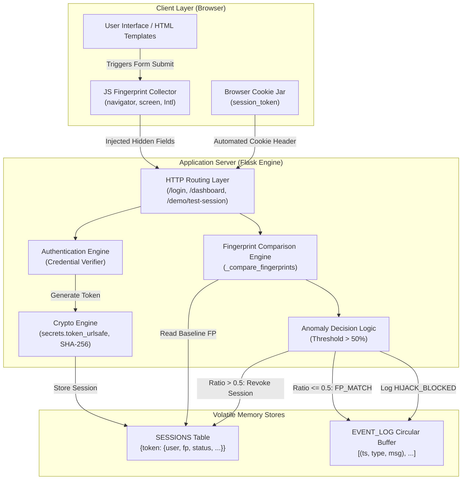
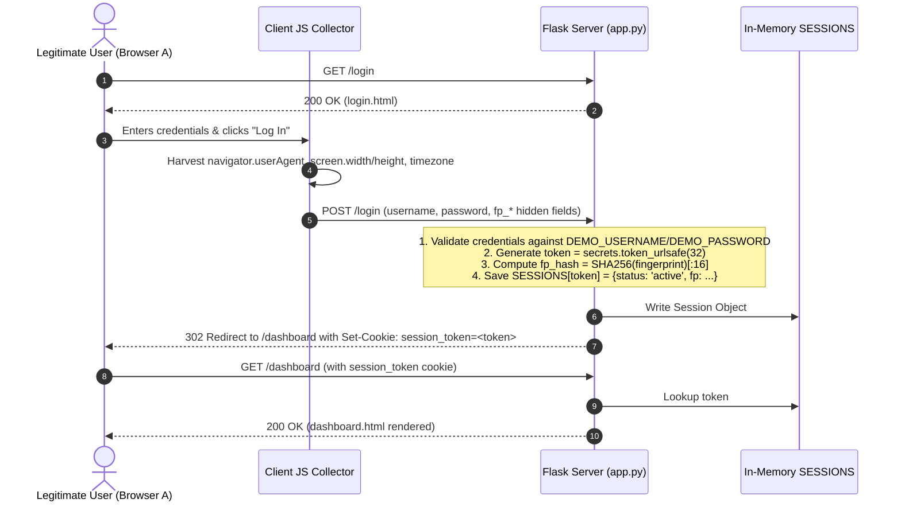
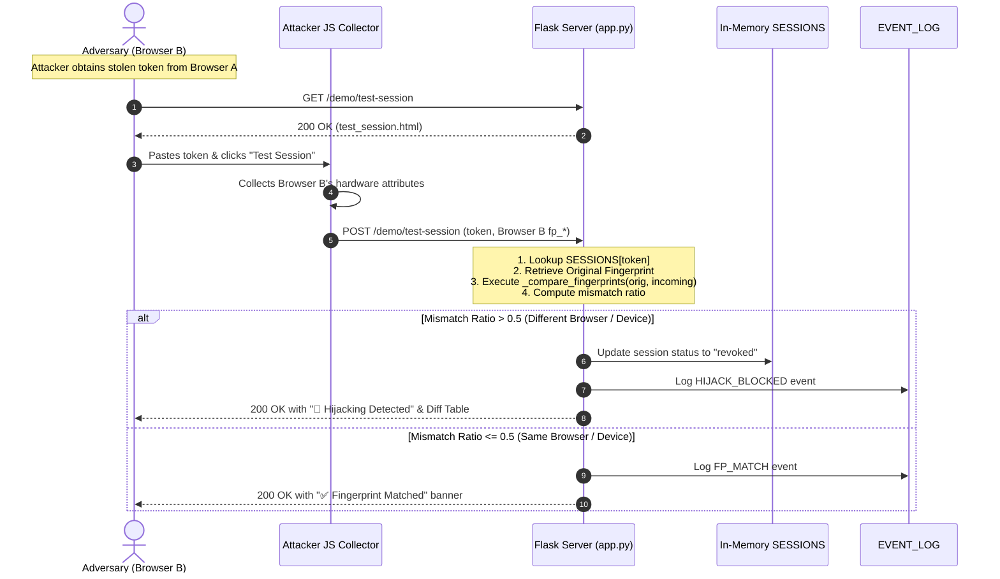

# 🏛️ System Architecture, Data Flow & Technical Specification

> **Project:** Behavioral Fingerprint-Based Detection of Session Hijacking  
> **Repository:** `session-hijacking-detection-demo`  
> **Author:** College Demonstration Framework  

---

## 1. Problem Statement

### 1.1 The Inherent Flaw of Bearer Tokens
In contemporary HTTP web applications, HTTP is stateless. To maintain user identity across discrete requests, web applications issue an authentication token (typically persisted as a browser cookie, session ID, or JSON Web Token). 

Under the standard **bearer token model**:
$$\text{Access Granted} \iff \text{Valid Token Presented}$$

The server implicitly trusts that whoever sends the token is the legitimate entity to whom the token was issued. The server does not intrinsically know *which machine* or *what browser* generated the request.

```
+---------------+                    +---------------+
| Legitimate    |--- Valid Token --->|               |
| User Browser  |                    |               |
+---------------+                    | Web Server /  |
                                     | API Gateway   |
+---------------+                    |               |
| Attacker      |--- Stolen Token -->|               |
| (Compromised) |   (Identical!)     +---------------+
+---------------+
```

### 1.2 Session Hijacking Attack Vectors (Threat Landscape)
Session hijacking occurs when an unauthorized third party intercepts, predicts, or extracts this bearer token. Common real-world vectors include:
1. **Cross-Site Scripting (XSS - CWE-79):** Malicious JavaScript executes in the victim's DOM and reads `document.cookie`.
2. **Man-in-the-Middle (MitM) & Insecure Wi-Fi Sniffing (CWE-319):** Eavesdropping unencrypted or poorly configured network packets over public hotspots.
3. **Malware & Infostealers:** Trojan software scanning local browser SQLite profile databases (`Cookies` and `Local Storage` files).
4. **Session Fixation (CWE-384):** Forcing a pre-known session token onto a victim prior to authentication.
5. **Physical / Shoulder Surfing Access:** Extracting active session tokens from unattended terminals.

Once the token is stolen, the attacker injects it into their own browser or automated HTTP tool (`curl`, Postman). Standard servers accept it unconditionally.

---

## 2. Proposed Solution: Behavioral Fingerprinting

To defeat session hijacking without degrading user experience with continuous multi-factor authentication (MFA) prompts, we implement **Client-Side Behavioral Fingerprinting**:

1. **Fingerprint Harvesting:** During user authentication, client-side JavaScript extracts passive hardware, OS, and software environment characteristics.
2. **Cryptographic Binding:** The server creates a cryptographically secure token and binds it in memory to the harvested fingerprint vector:
   $$\text{Session} = \{ \text{Token}, \text{User}, \text{FingerprintVector}, \text{Status} \}$$
3. **Continuous Re-verification:** On every subsequent access attempt or test submission, the incoming client environment is fingerprinted and evaluated against the stored baseline.
4. **Autonomous Invalidation:** If the variance across fingerprint attributes exceeds the anomaly threshold ($>50\%$), the session is instantly invalidated across the entire server cluster.

---

## 3. System Architecture & Block Diagram



---

## 4. End-to-End Data Flow

### 4.1 Flow 1: Legitimate User Authentication & Binding



---

### 4.2 Flow 2: Attacker Simulation & Detection



---

### 4.3 Flow 3: Victim Invalidation & Real-Time Kick-out

```mermaid
sequenceDiagram
    autonumber
    actor Victim as Legitimate User (Browser A)
    participant Flask as Flask Server (app.py)
    participant Store as In-Memory SESSIONS

    Note over Victim: Victim refreshes or navigates on /dashboard
    Victim->>Flask: GET /dashboard (Cookie: session_token=<token>)
    Flask->>Store: SESSIONS.get(token)
    Note over Flask: Token exists but status == 'revoked'!
    Flask-->>Victim: 302 Redirect to /login (Set-Cookie: session_token=; Max-Age=0)
    Note over Victim: Browser clears cookie; User is redirected to login page
```

---

## 5. Technical Component Deep Dive

### 5.1 Client-Side Fingerprint Harvester
Captured on form submission in `login.html` and `test_session.html`:
```javascript
document.getElementById("fp_user_agent").value    = navigator.userAgent;
document.getElementById("fp_screen_width").value  = screen.width;
document.getElementById("fp_screen_height").value = screen.height;
document.getElementById("fp_timezone").value      = Intl.DateTimeFormat().resolvedOptions().timeZone;
```

#### Selected Signals Rationale:
- **`navigator.userAgent`**: Identifies browser software family, layout engine (Gecko, Blink, WebKit), operating system, and architecture.
- **`screen.width` & `screen.height`**: Hardware display resolution. Unlike viewport dimensions (`window.innerWidth`), screen dimensions remain invariant across window resizes, zoom levels, and scrolling.
- **`Intl.DateTimeFormat().resolvedOptions().timeZone`**: The client's configured IANA geographic timezone (e.g., `Asia/Kolkata`, `America/New_York`), detecting geographically dispersed session use.

---

### 5.2 Server-Side Data Structures (`app.py`)

#### `SESSIONS` Storage Schema:
```python
SESSIONS = {
    "token_string_43_chars": {
        "username": "student",
        "fingerprint": {
            "user_agent": "Mozilla/5.0 (Windows NT 10.0; Win64; x64)...",
            "screen_width": "1920",
            "screen_height": "1080",
            "timezone": "Asia/Kolkata"
        },
        "fp_hash": "a4f8c2e91b7d30f4",
        "created_at": datetime.datetime(2026, 10, 25, 22, 0, 0),
        "status": "active"  # "active" | "suspicious" | "revoked"
    }
}
```

#### `EVENT_LOG` Circular Buffer:
Stores up to 50 security audit tuples `(timestamp, event_type, message)`. Older events are automatically pruned (`EVENT_LOG.pop(0)`) to maintain bounded memory consumption.

---

### 5.3 Detection Heuristics & Decision Algorithm

```python
FINGERPRINT_FIELDS = ["user_agent", "screen_width", "screen_height", "timezone"]
MISMATCH_THRESHOLD = 0.5  # 50% majority threshold

def _compare_fingerprints(original: dict, incoming: dict) -> dict:
    matched = []
    mismatched = []
    for field in FINGERPRINT_FIELDS:
        orig_val = str(original.get(field, "")).strip()
        in_val   = str(incoming.get(field, "")).strip()
        if orig_val == in_val:
            matched.append(field)
        else:
            mismatched.append(field)
    
    mismatch_ratio = len(mismatched) / len(FINGERPRINT_FIELDS)
    return {
        "matched": matched,
        "mismatched": mismatched,
        "mismatch_ratio": mismatch_ratio,
        "suspicious": mismatch_ratio > MISMATCH_THRESHOLD,
    }
```

#### Mathematical Decision Rule:
$$\text{Mismatch Ratio} = \frac{|\text{Mismatched Fields}|}{|\text{Total Fields}|}$$
$$\text{Action} = 
\begin{cases} 
\text{REVOKE \& BLOCK}, & \text{if } \text{Mismatch Ratio} > 0.5 \\
\text{PERMIT ACCESS}, & \text{if } \text{Mismatch Ratio} \le 0.5 
\end{cases}$$

#### Why the >50% Majority Threshold?
- **Single-field variance:** If a browser receives a minor background version update (e.g., Chrome 120.0 to 120.1) or a connected external monitor alters display resolution, only 1 of 4 fields changes ($25\% \le 50\%$). The session remains active, preventing annoying false positive lockouts.
- **Cross-device / Cross-browser attacks:** An attacker operating from another machine typically produces discrepancies across `user_agent` (e.g., Firefox vs Chrome), `screen_width`, and `screen_height` ($\ge 75\% > 50\%$), reliably triggering revocation.

---

## 6. Threat Model & Security Analysis (STRIDE)

| Threat Category | Potential Attack Vector | System Defense Mechanism |
|---|---|---|
| **Spoofing Identity** | Adversary presents stolen bearer token from another device. | Mismatch in browser fingerprint exceeds 50% threshold; session is immediately revoked. |
| **Tampering** | Attacker tampers with session token string. | `secrets.token_urlsafe(32)` provides 256 bits of entropy; non-existent tokens are rejected immediately. |
| **Repudiation** | User claims actions were taken by a hijacker. | `EVENT_LOG` stores chronological audit trails of token issuance, verification, and revocation. |
| **Information Disclosure** | Token intercepted over unencrypted channels. | Demonstration highlights need for HTTPS and `HttpOnly` cookie attributes; fingerprint comparison provides secondary defense. |
| **Denial of Service** | Flooding invalid tokens to exhaust memory. | Bounded `EVENT_LOG` (max 50 items); token length validation. |
| **Elevation of Privilege** | Hijacker attempts to execute administrative actions. | Immediate revocation blocks all further route access before privilege evaluation occurs. |

---

## 7. Real-World Production Roadmap

While this project is optimized for transparent academic demonstration, an enterprise production architecture would incorporate the following enhancements:

```
+-------------------------------------------------------------------------+
|                  Enterprise Defense-in-Depth Pipeline                   |
+-------------------------------------------------------------------------+
| 1. Transport Layer : TLS 1.3 + JA3/JA4 Fingerprinting (OS cipher order) |
| 2. Network Layer   : Subnet / ASN Binding + Max Geovelocity checks       |
| 3. Cookie Hardening: HttpOnly, Secure, SameSite=Strict, __Host- prefix  |
| 4. Client Hardware : HTML5 Canvas rendering + WebGL GPU Renderer digest |
| 5. Distributed Ops : Redis Cluster with sliding TTL session expiration  |
+-------------------------------------------------------------------------+
```
